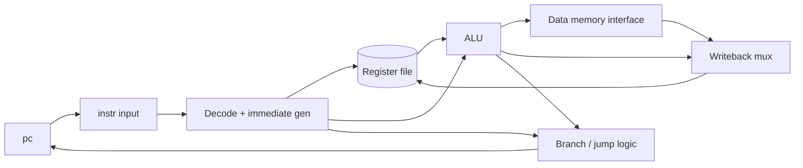

# RV32I RISC-V Core Verification Starter


A small, educational single-cycle RV32I-style processor starter with an Icarus-Verilog-compatible self-checking testbench. It is designed to be extended incrementally into a portfolio project.

> **Scope warning:** This is an educational starter, not a complete or validated RV32I implementation. Treat unsupported encodings as out of scope until they are added and tested.

> **UVM note:** Icarus Verilog does not support the full standard class-based UVM environment. This starter intentionally uses a procedural testbench so it can run with Icarus first.

---

## Table of Contents
1. [Current Scope](#current-scope)
2. [Not Implemented](#not-implemented)
3. [Requirements](#requirements)
4. [Quick Start](#quick-start)
5. [Repository Layout](#repository-layout)
6. [Architecture](#architecture)
7. [Interface](#interface)
8. [Verification Plan](#verification-plan)
9. [Troubleshooting](#troubleshooting)
10. [Limitations](#limitations)
11. [Roadmap](#roadmap)
12. [Status](#status)

---

## Current Scope

The starter RTL implements a useful subset of RV32I:

| Category         | Instructions                                                              |
|------------------|---------------------------------------------------------------------------|
| R-type           | `ADD`, `SUB`, `AND`, `OR`, `XOR`, `SLT`, `SLTU`, `SLL`, `SRL`, `SRA`      |
| I-type ALU       | `ADDI`, `ANDI`, `ORI`, `XORI`, `SLTI`, `SLTIU`, `SLLI`, `SRLI`, `SRAI`   |
| Memory           | `LW`, `SW`                                                                |
| Control flow     | `BEQ`, `BNE`, `JAL`, `JALR`                                               |
| Upper immediate  | `LUI`, `AUIPC`                                                            |

**Total:** 30 instructions.

## Not Implemented

These are outside the current scope. Do not rely on them.

| Area                        | Status                                                         |
|-----------------------------|----------------------------------------------------------------|
| Other branches              | `BLT`, `BGE`, `BLTU`, `BGEU` are not listed in scope           |
| Sub-word loads and stores   | `LB`, `LBU`, `LH`, `LHU`, `SB`, `SH` are not listed in scope   |
| `FENCE` family              | Not implemented                                                |
| `ECALL` / `EBREAK`          | Not listed in scope                                            |
| Exceptions, CSRs, interrupts, privilege modes | Not implemented                              |
| Misaligned memory access    | Not handled; the memory model assumes aligned word accesses    |
| Illegal-instruction handling| Minimal                                                        |

## Requirements

Icarus Verilog with SystemVerilog support (`-g2012`). On macOS:

```bash
brew install icarus-verilog
```

## Quick Start

From the project root:

```bash
./scripts/run.sh
```

Or run manually:

```bash
iverilog -g2012 -s tb_rv32i_core -o /tmp/rv32i_sim rtl/rv32i_core.sv tb/tb_rv32i_core.sv
vvp /tmp/rv32i_sim
```

**Expected ending:**

```text
PASS: RV32I starter tests passed
```

If the final line is anything else, treat the run as a failure, even if the process exits cleanly.

## Repository Layout

| Path                    | Purpose                                                          | State    |
|-------------------------|------------------------------------------------------------------|----------|
| `rtl/rv32i_core.sv`     | Single-cycle core with instruction input and simple data memory interface | Active   |
| `tb/tb_rv32i_core.sv`   | Self-checking testbench with a small instruction program         | Active   |
| `scripts/run.sh`        | Compile and run                                                  | Active   |
| `tests/`                | Future directed and randomized test programs                     | Reserved |
| `assertions/`           | Future assertions                                                | Reserved |
| `reports/`              | Generated logs                                                   | Output   |

## Architecture

Single-cycle datapath: each instruction is fetched, decoded, executed, and committed in one clock cycle.



> The diagram is a generic single-cycle layout. Adjust block names to match `rtl/rv32i_core.sv`.

## Interface

The core fetches an instruction from `instr` at `pc`. The testbench supplies instructions combinationally. Data memory is exposed through a simple interface.

| Signal      | Dir | Description                                  |
|-------------|-----|----------------------------------------------|
| `pc`        | out | Address of the instruction being fetched     |
| `instr`     | in  | Instruction at `pc`, supplied combinationally by the testbench |
| `mem_addr`  | out | Data memory address                          |
| `mem_wdata` | out | Data memory write data                       |
| `mem_wstrb` | out | Data memory write strobe                     |
| `mem_we`    | out | Data memory write enable                     |
| `mem_rdata` | in  | Data memory read data                        |

> Your README does not state signal
